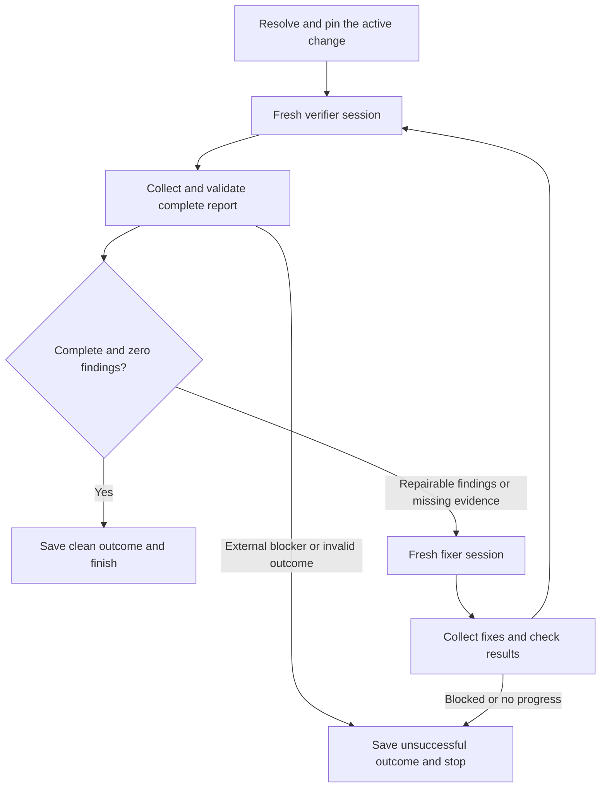

# Plan: reusable OpenSpec verification loop for OpenCode

Status: implemented and verified. See [README.md](README.md) for usage and
[docs/verification.md](docs/verification.md) for validation evidence and release limitations.

This plan carries forward the requirements discussed in @thread:thr_fanst5gpkj. The repository contained only Git metadata when planning started. Local tools inspected on November 1, 2026: OpenCode **2.2.5** and OpenSpec **1.16.0**. These became the initial compatibility targets; the verification record lists the client and runtime versions tested during implementation.

## 1. Intended result

Build an installable `openspec-verify-loop` skill, with a bundled TypeScript controller compiled to JavaScript, an OpenCode slash-command template, and verifier/fixer agent templates.

After installation and project setup, the user can run:

```text
/verify-loop
/verify-loop add-export
```

The workflow is:



Both worker roles use a **new session every round**. Workers execute sequentially in the same consuming checkout. The controller owns sequencing and completion; workers perform one assignment each.

Completion requires all of the following:

- A fresh verifier has finished a full verification of the pinned change.
- There are zero CRITICAL, WARNING, and SUGGESTION findings, including recommendations normalized into SUGGESTION.
- Previously reported findings have explicit resolutions supported by evidence.
- Every applicable check is verified; a justified `not_applicable` check is allowed.
- Required checks have passed against the revision reviewed by that verifier.
- No execution failure, incomplete report, or external blocker remains.

Continue productive rounds without a default round cap. Support explicit user limits and stop when the loop cannot proceed. A limit, cancellation, or blocker must never be reported as clean.

## 2. Architecture and compatibility decisions

Use these layers:

| Layer | Responsibility |
| --- | --- |
| `SKILL.md` | Resolve conversational intent, select the change, launch the controller, present progress and outcome |
| `/verify-loop` command | Load the installed skill and pass the optional argument as task input |
| Controller | Resolve project state, create sessions, collect results, validate reports, persist progress, decide transitions |
| Verifier profile | Execute the consuming project's actual `openspec-verify-change` procedure; inspect and report |
| Fixer profile | Address the complete finding set, run relevant checks, report evidence and unresolved items |
| Setup helper | Install project command and agent files without replacing unrelated configuration |

Use TypeScript and Node ESM for development and execution. Choose the supported Node version after validating the OpenCode client's service entrypoint. Bun may remain a development convenience, but consumers should not need it unless the compatibility spike demonstrates an unavoidable requirement.

Use `@opencode/client` behind a small adapter. Its documented `Service.ensure()` and `Service.headers()` provide local service discovery/startup and authentication. Allow an explicitly supplied server endpoint for standalone use; otherwise use the local service. Never stop a shared service when the controller exits. [OpenCode client documentation](https://dev.opencode.ai/v2/docs/build/client/)

The current API admits prompts asynchronously. A successful `session.prompt` response is submission evidence, not a verification verdict. Persist session and input identities, await terminal execution, and collect the corresponding persisted response. Use events for progress and reconcile with stored session state after reconnects. [OpenCode API reference](https://dev.opencode.ai/v2/docs/api)

Use namespaced worker IDs such as `openspec-loop-verifier` and `openspec-loop-fixer`. Start with `mode: all` for profiles launched directly as API sessions; prove agent selection during the spike. OpenCode documents `mode: subagent` as restricted to its subagent tool. Keep worker delegation disabled so the controller remains the sole loop owner. [OpenCode agents](https://dev.opencode.ai/v2/docs/agents/)

Models remain configurable per role. Do not hardcode Flint, LM Studio, or a provider. The defaults should resolve from the consuming project's OpenCode configuration and be saved in run metadata.

Scope the first release to repo-local OpenSpec changes in one checkout. Detect store-based or multi-repository targets and report an unsupported target before launching workers. Add store support later only with explicit rules for implementation roots and edit permissions.

## 3. Repository and release layout

```text
openspec-verify-loop/
├── PLAN.md
├── README.md
├── LICENSE                         # Select before public release
├── package.json
├── package-lock.json
├── tsconfig.json
├── src/
│   ├── cli.ts                      # run, setup, status, resume, stop
│   ├── controller.ts               # State transitions and completion policy
│   ├── opencode.ts                 # Version-specific client adapter
│   ├── openspec.ts                 # Change/procedure discovery and validation
│   ├── reports.ts                  # Schemas and semantic validation
│   ├── state.ts                    # Atomic persistence and exclusive locks
│   ├── prompts.ts                  # Worker prompt construction
│   └── setup.ts                    # Template rendering and installation
├── skills/
│   └── openspec-verify-loop/
│       ├── SKILL.md
│       ├── scripts/
│       │   └── controller.mjs       # Generated executable release bundle
│       ├── templates/
│       │   ├── verify-loop.md
│       │   ├── openspec-loop-verifier.md
│       │   └── openspec-loop-fixer.md
│       └── references/
│           └── report-contract.md
├── tests/
│   ├── controller.test.ts
│   ├── reports.test.ts
│   ├── state.test.ts
│   ├── setup.test.ts
│   └── fixtures/
└── .github/workflows/ci.yml
```

Keep modules small; combine files where separation adds no value. The runtime bundle is built from `src/`, never edited by hand. Keep substantial schema and worker-output details in the reference document; keep the skill entrypoint focused on invocation and operation.

The installed skill must contain everything needed to run the controller. Skill installation does not run a build or install npm dependencies. Bundle runtime dependencies where possible, inspect the service client's native/runtime requirements, and test the resulting installed directory in isolation. If dependencies cannot be bundled, resolve that packaging issue before claiming skill-only installation works.

For Git-based installation, include the generated bundle in the release source users install. Initially commit the bundle and have CI rebuild it and reject drift. This keeps local and Git installs usable without a consumer build step.

## 4. Change selection and preflight

Implement selection in one deterministic resolver, shared by direct CLI execution and the skill launcher:

1. An explicit change name wins; validate it against active changes.
2. Otherwise the launcher may supply a change clearly identified in the current conversation; validate it using the same resolver.
3. Otherwise read `openspec list --json`; select exactly one active change automatically.
4. With multiple active changes, return a structured `selection_required` result listing candidates. The launcher asks the user to select one.
5. With no active changes, return `no_active_change`; start no worker.

A terminal invocation without conversational context follows steps 1, 3, 4, and 5. It returns candidates instead of inventing a selection. Never choose based only on recency or task completion percentage.

Use argument arrays when invoking programs; never interpolate a change name into shell code. Validate names using the supported OpenSpec contract and active-list membership, and ensure the canonical target is within the selected repo-local changes directory.

Read OpenSpec's returned root and change paths rather than assuming the shell's current directory is the project root. Pin the real checkout, change name/path, schema, verification skill path/digest, agent definitions, model selections, and relevant configuration. The documented JSON contract distinguishes planning completeness from implementation completeness. [OpenSpec agent contract](https://github.com/Fission-AI/OpenSpec/blob/main/docs/agent-contract.md)

Preflight should:

- Confirm supported OpenCode, client, OpenSpec, and runtime versions.
- Resolve the consuming project's actual `openspec-verify-change` skill through supported skill discovery, with an explicit path option for disambiguation.
- Require that procedure to exist and be readable; do not substitute a generic review prompt.
- Preserve its resource base directory and load referenced resources when needed.
- Read the named change's artifacts and relevant apply/status metadata.
- Run spec validation using the supported CLI flags and save the result.
- Acquire an exclusive lock for the canonical checkout before any worker starts; reject concurrent loops even when they target different changes in the same checkout.
- Record existing tracked and untracked work so workers preserve it; a dirty tree is allowed.

Missing infrastructure or an invalid target is a prerequisite failure. Repairable spec/implementation gaps become findings once there is enough valid context to perform verification. Do not silently initialize OpenSpec, install tools, change providers, archive changes, or rewrite requirements to make verification pass.

## 5. Report contract and acceptance policy

Define versioned runtime-validated JSON schemas for verifier and fixer results. Preserve the complete human-readable OpenSpec report alongside its structured representation.

Verifier result fields:

```text
schemaVersion, runId, round, role, changeName, targetPath
verificationComplete, outcome: clean | findings | blocked
findings[]:
  id, severity: critical | warning | suggestion
  category, title, explanation, locations[], recommendation
checks[]:
  id, description, status: verified | failed | not_verified | not_applicable
  evidence[], reason
priorFindingResolutions[]:
  findingId, status: resolved | unresolved | not_applicable, evidence[], reason
blockers[]
fullReportMarkdown
```

Fixer result fields:

```text
schemaVersion, runId, round, role, changeName, targetPath
outcome: completed | blocked
addressedFindings[], unresolvedFindings[], changedFiles[]
checksRun[]: command, workingDirectory, exitCode, evidence, summary
blockers[], fullReportMarkdown
```

Attach session/input IDs and observed workspace fingerprints in the controller's own envelope rather than trusting worker-provided identities. Use stable finding identifiers carried between rounds, but do not depend on exact wording to detect unresolved work.

Initially request one JSON object as the worker's final response, containing the full report Markdown. Parse only the final response for the expected input. Reject missing, truncated, duplicate, or malformed objects; do not scrape the first JSON-looking substring out of a transcript. Investigate native schema enforcement during the API spike and use it only if the pinned API supports it.

Semantic validation must reject inconsistent outcomes: `clean` with any finding, failure, blocker, missing prior resolution, or applicable unverified check is invalid. A check marked `not_applicable` needs a reason. Unknown severities must not disappear during normalization. Unsupported or contradictory report data stops advancement with a specific diagnostic.

Always pass the **complete latest report**, unresolved earlier findings, pinned context, and latest fixer evidence to the next appropriate worker. Persist all earlier reports for audit; avoid forwarding the entire growing conversation. If a report cannot fit, let workers read the saved report with an explicit completeness requirement; never silently drop findings.

OpenSpec verification covers completeness, correctness, and coherence and uses CRITICAL, WARNING, and SUGGESTION findings. This project's completion policy deliberately requires zero findings at every level. [OpenSpec reviewing guide](https://github.com/Fission-AI/OpenSpec/blob/main/docs/reviewing-changes.md)

## 6. Worker behavior and permissions

Verifier prompt:

- Execute the pinned project's full verification procedure on every round, with its actual resource directory and artifact context.
- Inspect code, artifacts, tests, and the full relevant diff, including uncommitted work.
- Recheck previous findings and look for newly introduced problems.
- Run applicable checks and report missing evidence explicitly.
- Return the structured contract and complete report.
- Leave implementation, task tracking, specs, and archival state unchanged.

Enforce edit restrictions through the verifier profile. Permit only configured inspection/check commands; denying edit tools alone does not prevent shell writes. Some check commands generate caches or build artifacts, so describe the verifier as inspection-focused rather than claiming a filesystem sandbox. Include a workspace-change check after verification and stop if unexpected source edits occurred.

Fixer prompt:

- Address every finding in scope, including warnings and suggestions.
- Recover repairable missing verification evidence, including necessary tests.
- Preserve unrelated work and avoid weakening tests or removing requirements to hide failures.
- Update task completion evidence only when justified by the implementation.
- Report a requirement/design decision that needs user input as a blocker.
- Run relevant checks and report the actual outcomes and unresolved findings.
- Return control after this fix assignment; do not launch another round.

Use project permissions for check execution and editing; do not enable blanket auto-approval. If a worker requests permission or user input, record an awaiting-input condition and surface it through the launcher/status output. Do not pretend the loop is making progress while blocked on an invisible prompt. Prove this path during integration testing.

Neither role commits, pushes, merges, deploys, or archives as part of the loop.

## 7. Durable controller and run state

Implement explicit transitions:

```text
preflight → verifying → evaluating → fixing → verifying → ... → clean
                                      |
Any active phase → awaiting_input | blocked | failed | interrupted | limited
```

Persist a write-ahead dispatch record before creating/submitting work. Save generated session/input identities as soon as available. Reconcile an uncertain response with server state rather than blindly submitting the same assignment again. Test whether caller-assigned IDs provide idempotency on the pinned API; do not assume it.

Store runs outside the installed skill and project source tree, under a platform-appropriate user state directory keyed by the canonical checkout, with a configurable `--state-dir` override:

```text
<state-root>/<project-key>/<run-id>/
  state.json
  events.jsonl
  rounds/001/verifier.json
  rounds/001/verifier.md
  rounds/001/fixer.json
  rounds/001/fixer.md
  final.json
  final.md
```

State includes schema/controller versions, pinned target/config/procedure hashes, phase, round, pending worker/input, latest accepted reports, unresolved findings, progress fingerprints, timestamps, and termination reason. Write state and accepted reports atomically, and make completion collection idempotent.

Resume must:

- Be explicit; a newly invoked command must not adopt an older stopped run.
- Reacquire the checkout lock and verify target/procedure/config compatibility.
- Reconcile the pending worker and stored response before spawning anything.
- Refuse to start another fixer while an earlier worker may still be running.
- Require a fresh verification after a recovered fixer outcome or an intervening workspace change.

Record proposal/spec/design hashes separately from task-state changes and implementation fingerprints. A changed requirement set invalidates the run's pinned scope; report that and require an explicit new or resumed run after review.

Stop handling must interrupt the current worker and confirm its terminal state before releasing exclusive ownership. If confirmation is impossible, retain a recoverable pending-worker record and reject conflicting runs until reconciliation.

Detect stalled cycles from repeated normalized findings plus unchanged relevant workspace/evidence. Stop after two consecutive fix cycles with no demonstrable progress; persist both reports and explain the unresolved items. Changed wording alone does not count as progress. Optional round/time limits are explicit unsuccessful outcomes, and timing budgets include recovery work.

Suggested CLI exit categories: `0` clean; `2` selection/no active change; `3` blocked/awaiting input; `4` execution or contract failure; `5` explicit limit; `130` interruption. Status output should include a machine-readable outcome so callers need not infer meaning from exit codes alone.

## 8. Skill, command, and installation experience

Write a concise skill description that applies to iterative OpenSpec verify/fix requests and explicit invocation. Keep one-pass review outside its trigger.

The skill instructions should cover selection, launch, progress, resumption, final reporting, and the exact clean condition. Paths to the controller must resolve relative to the installed skill, independently of the consuming checkout.

The command template loads this skill and forwards `$ARGUMENTS` as user input. It must not embed raw arguments in shell substitutions. The launcher parses supported options and invokes the controller with safely quoted arguments.

Launch the long-running controller using OpenCode's background shell execution. Save and report the run ID/state path immediately; after completion, read `final.json` and summarize its outcome. If the launching chat is closed, the saved status remains available; do not promise automatic chat recovery without verifying that behavior. [OpenCode commands](https://dev.opencode.ai/v2/docs/commands/), [shell execution](https://dev.opencode.ai/v2/docs/tools/)

Proposed controller interface, implemented through the bundled executable:

```text
node <installed-skill>/scripts/controller.mjs setup --project .
node <installed-skill>/scripts/controller.mjs run --project . [--change add-export]
node <installed-skill>/scripts/controller.mjs status --project . --run <run-id>
node <installed-skill>/scripts/controller.mjs resume --project . --run <run-id>
node <installed-skill>/scripts/controller.mjs stop --project . --run <run-id>
```

Support configuration for verifier/fixer models, explicit verification-skill path, required check commands, state directory, endpoint, and optional round/time limits. Use one documented precedence: explicit CLI options, project loop configuration, then defaults. Persist effective values. Keep credentials in the existing OpenCode authentication mechanisms.

Setup installs:

```text
.opencode/commands/verify-loop.md
.opencode/agents/openspec-loop-verifier.md
.opencode/agents/openspec-loop-fixer.md
```

Make setup idempotent. Create missing files, retain identical files, and update only recognized untouched generated files. Refuse to overwrite customized files and show a diff/explicit replacement option. Record ownership/version metadata for upgrades and removal. Do not alter existing `opencode.json` or model/provider settings. Ensure live OpenCode sessions reload newly installed definitions through the supported mechanism.

OpenCode discovers skills, commands, and agent definitions independently, so copying the skill directory alone is insufficient for the slash-command experience. [OpenCode skills](https://dev.opencode.ai/v2/docs/skills/)

During development, document a local install using the Skills CLI, followed by setup using the actual installed directory. Verify both copy and symlink layouts. Once a Git source is published, the intended install is:

```text
npx skills add OWNER/openspec-verify-loop --skill openspec-verify-loop -a opencode
```

`OWNER` is a placeholder until the repository source is known. The installer supports local paths and targeted agents. Treat setup as a separate documented step; skill installers do not automatically register these templates. [Skills CLI reference](https://github.com/vercel-labs/skills/blob/main/docs/commands.md)

An npm executable providing a one-command install can follow once the Git-installable skill works. Do not make npm publication a prerequisite for the first usable version.

## 9. Implementation sequence and acceptance gates

### Milestone 1: prove the OpenCode integration

Create a minimal development package and adapter spike in an isolated fixture project. Pin the compatible client package, Node version, and OpenCode/OpenSpec versions.

Prove session creation with the intended worker profile, prompt submission, terminal detection, final-result collection, configured model selection, cancellation, permissions, and loading the actual project verification skill. Test the client service entrypoint from the release bundle. Keep this initial probe small; do not build the full controller against unverified method assumptions.

**Gate:** one verifier assignment produces a correctly correlated saved response through the intended runtime; an interrupted or denied assignment cannot look clean. Record any API limitations and adjust the adapter before continuing.

### Milestone 2: schemas and deterministic loop core

Implement report schemas, semantic validation, change resolution, transitions, and completion policy against a fake adapter. Add report serialization and findings handoff.

**Gate:** a scripted `verify(findings) → fix → verify(clean)` completes, every worker receives a distinct session, every finding is forwarded, and invalid/incomplete results stop the loop.

### Milestone 3: persistence and recovery

Implement atomic state, checkout locking, write-ahead dispatch, request correlation, explicit resume/stop/status, progress detection, and limit handling.

**Gate:** injected crashes before/after submission, collection, and state updates recover without duplicate fixers, lost findings, or stale clean outcomes.

### Milestone 4: real worker integration

Connect the adapter to the loop core, implement role prompts and profiles, resolve the project's actual OpenSpec procedure, and run sequential workers in one fixture checkout.

**Gate:** real verifier/fixer rounds repair a deliberately introduced mismatch, then produce a fresh full clean verification with check evidence. This is a controlled integration exercise, not a loop over unrelated user projects.

### Milestone 5: installable skill and setup

Write `SKILL.md`, command/agent templates, setup logic, compiled release bundle, and user documentation. Verify the skill and command can locate the runtime from copied and symlinked installation paths.

**Gate:** a fresh consumer project installs the skill locally, runs setup twice safely, discovers `/verify-loop`, and completes both explicit-name and single-active-change invocations without access to this source checkout or development dependencies.

### Milestone 6: release preparation

Add CI for type checking, meaningful tests, build reproducibility, isolated installation, and skill/frontmatter validation. Document supported versions, permissions, configuration, output locations, troubleshooting, and recovery. Select a license and actual distribution source before publishing.

**Gate:** every acceptance scenario below passes or is recorded as an explicit unsupported capability; the documented basic workflow has no unverified dependency or packaging step.

## 10. Validation scenarios

Use fast deterministic adapter tests for control flow and a small opt-in live integration suite for actual model behavior. Live tests use isolated fixtures and explicit configured models; keep them out of routine CI unless credentials and cost controls are available.

| Scenario | Required observable result |
| --- | --- |
| First verifier is clean | No fixer; success with saved complete evidence |
| Critical + warning + suggestion | Fixer receives and addresses all three severities |
| New issue introduced by a fix | Next full verifier finds it; loop continues |
| Finding disappears without resolution evidence | Completion rejected |
| Applicable check lacks evidence | Fix missing evidence or report blocker; never clean |
| Justified non-applicable check | Does not prevent clean completion |
| Empty, malformed, partial, or contradictory report | Unsuccessful outcome; no subsequent fixer based on guessed content |
| Prompt accepted, worker later fails | Failure correlated to that assignment; no stale response reused |
| Event missed or connection lost | Reconcile persisted state; do not duplicate dispatch |
| Controller crashes at a transition | Explicit resume produces at most one active worker |
| User stops while fixer is running | Interrupt/reconcile before another run can edit |
| Same unresolved findings and no progress | Stop with evidence of the stalled cycles |
| Multiple/no active changes | Selection request or no-work result; no worker starts |
| Change archived/removed or procedure changed | Stop with the specific changed prerequisite |
| Dirty tree and unrelated untracked files | Preserve user work through verification/fixing |
| Another loop targets the same checkout | Refuse conflicting execution |
| Verifier attempts source edits | Permission denial or mutation detection; reject verification |
| Permission request or interactive question | Visible awaiting-input state; no false completion |
| Configured model unavailable | Explicit prerequisite failure; no silent model substitution |
| Explicit round/time limit reached | Limited outcome and resumable evidence; nonzero exit |
| Copy/symlink install, spaces in paths, relocated project | Runtime/resources resolve and execute correctly |
| Runtime bundle in a clean environment | No hidden dependency on source files or dev `node_modules` |
| Setup repeated or customized file present | Idempotent success or precise conflict; preserve customization |
| Store/multi-repo target supplied to first release | Clear unsupported-target result before edits |

The first release is ready when a user can install it into an independent OpenCode/OpenSpec project, invoke `/verify-loop` without a change name when selection is unambiguous, observe fresh sequential workers, and receive either a fully evidenced zero-finding result or a precise saved unsuccessful outcome.
